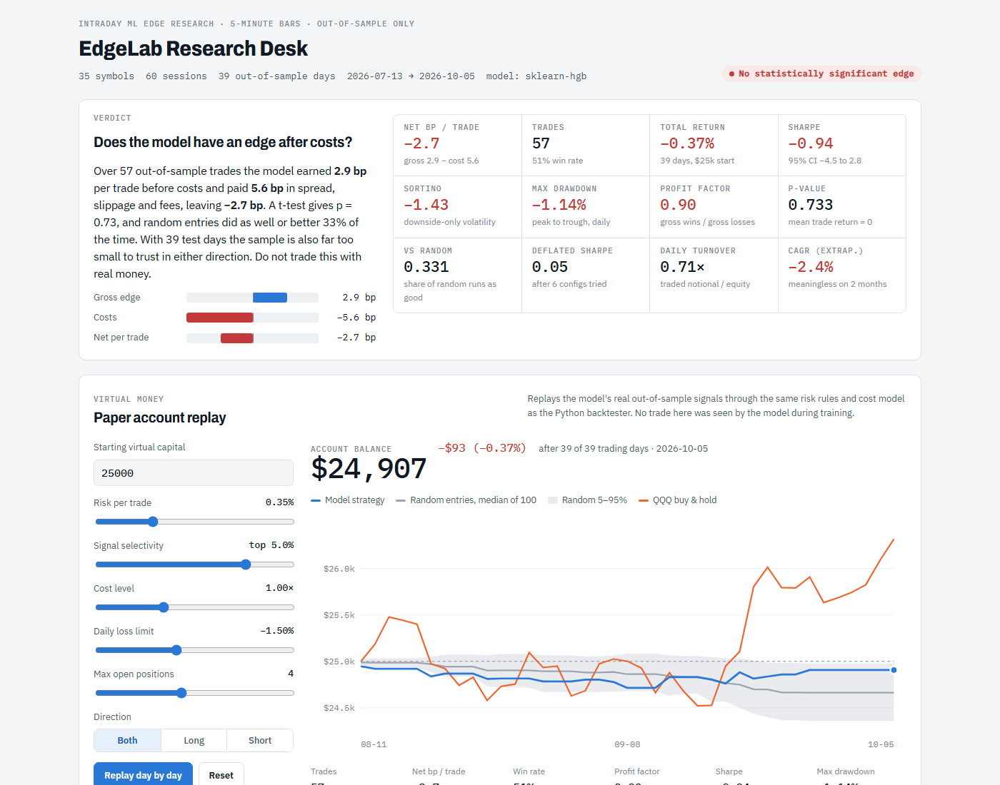

# EdgeLab

**Does an intraday machine-learning strategy on liquid US stocks have a real edge after costs?**
EdgeLab is a research system built to answer that honestly, and to make it hard to fool yourself.

The default assumption is **no edge**: the strategy has to prove otherwise out-of-sample, after spread, slippage
and fees, against random-entry baselines, with every tried variant counted against it.



## First result: no edge (yet)

On the free 60-day window of 5-minute bars for 35 liquid US stocks:

| | |
|---|---|
| Out-of-sample trades | 57 |
| Gross edge | +2.9 bp per trade |
| Costs (spread, slippage, fees) | −5.6 bp per trade |
| **Net** | **−2.7 bp per trade**, p = 0.73 |
| vs. random entries | random did as well or better 33% of the time |
| Deflated Sharpe (6 configs tried) | 0.05 |

The model's AUC of ~0.75 looked impressive, but it was measuring **volatility, not direction** (direction AUC 0.51).
That's exactly the kind of trap the system is designed to expose. The full reasoning is in [DESIGN.md](DESIGN.md).

## What's inside

- **Point-in-time features** on 5-minute bars, with a [no-look-ahead test](tests/test_no_lookahead.py)
- **Volatility-scaled triple-barrier labels** instead of a fixed "+0.4% in 30 minutes" target
- **Walk-forward validation** with purging and embargo, so no information leaks across folds
- **Shallow gradient-boosted trees** with a logistic-regression baseline the model has to beat
- **A realistic cost model** and deterministic risk rules shared by the backtester and the paper-trading loop
- **Honest metrics**: net bp per trade, bootstrap confidence intervals, random-entry baselines, Deflated Sharpe
- **An interactive dashboard** that replays the out-of-sample signals as a virtual-money account you can tweak
  (risk per trade, selectivity, costs, loss limits, long/short)
- **Optional paper trading** through Alpaca, with live trading locked behind explicit stage gates

## Run it

Requires Python 3.11+.

```bash
python -m venv .venv
.venv/Scripts/pip install -r requirements.txt        # Windows; use .venv/bin/pip on macOS/Linux
.venv/Scripts/python scripts/run_research.py          # download data, walk-forward, backtest, dashboard
.venv/Scripts/python tests/test_no_lookahead.py       # leakage test
.venv/Scripts/python scripts/paper_trade.py --dry-run # paper loop without a broker (market hours)
```

Outputs go to `results/` (`report.json`, `trades.csv`) and `dashboard/edgelab_dashboard.html` (open it in a browser).

Market data comes from Yahoo Finance via `yfinance`, which only serves the last 60 days of 5-minute bars.
Run `run_research.py` once a day: the local parquet cache keeps accumulating bars beyond that window,
so the sample grows over time. Downloaded data stays on your machine and isn't part of this repository.

### Paper trading (optional)

`pip install alpaca-py`, set `ALPACA_KEY_ID` and `ALPACA_SECRET_KEY` in your environment, then run
`scripts/paper_trade.py`. Paper trading is the default. Live trading is disabled unless `EDGELAB_LIVE_CONFIRM` is set,
and you shouldn't set it before the strategy passes the stage gates in [DESIGN.md §9](DESIGN.md).

## Project layout

```
edgelab/             data, features, labels, validation, model, risk, costs, backtest, metrics, research pipeline
edgelab/execution/   broker interface (dry-run and Alpaca)
scripts/             run_research.py, paper_trade.py, build_dashboard.py
dashboard/           template.html (the built dashboard is generated)
tests/               look-ahead leakage test
DESIGN.md            the full research design and its skeptical framing
```

## Disclaimer

This is a research project, not investment advice. Nothing here is a recommendation to buy or sell anything,
and the results above say *don't* trade this strategy with real money.

## License

[MIT](LICENSE)
